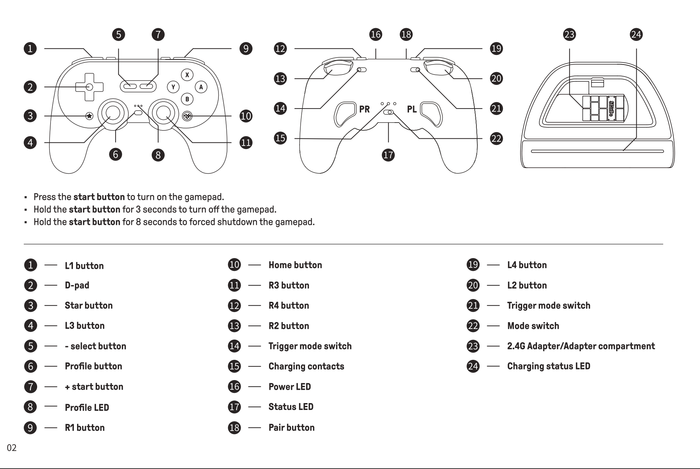

# Red-Crash ROS2 Jazzy

This is the ROS2 Jazzy workspace for the red-crash robotics project.

## The Robot

- Computer: Orange Pi 5B, hostname `red-crash-b`, user `pi`
  (`ssh pi@red-crash-b.local`)
- Motors: RoboClaw motor controller (`/dev/roboclaw`)
- Camera: OAK-D (`/dev/oak-d`)
- Lidar (`/dev/lidar`)
- Audio: ReSpeaker microphone and speaker
- Controller: 8BitDo Pro 3 with 2.4 GHz receiver
- USB hub with per-port power switches

## Daily Use

1. Switch on all ports on the USB hub.
2. Power on the robot.
3. The `car` container and all nodes start on boot. If `docker ps` doesn't
   show `car`, run `docker start car` (not `./start`, which creates a new
   container).
4. Turn on the controller (see below).
5. Push-to-talk, AI chat and the costume button need internet. The OpenAI key
   lives in `secrets.env` at the repo root (see `secrets_setup.md`).
6. Shut down with `sudo shutdown now` before cutting power.

## Prerequisites

Install Git LFS (required for voice model files):
```bash
sudo apt-get install git-lfs
git lfs install
```

Then clone normally - LFS files will be downloaded automatically:
```bash
git clone https://github.com/berickson/red-crash.git
```

## Quick Start

### 1. Build the Docker Image

```bash
cd docker
./build
```

This creates the `brianerickson/ros2-jazzy` image with ROS2 Jazzy, Navigation2, DepthAI drivers, and speech recognition.

### 2. Start the Container

Before starting the container, make sure all ports on the USB hub are switched on.

```bash
cd docker
./start
```

This starts the `car` container with:
- Working directory: `/root/ros2_ws`
- ROS2 workspace: `~/red-crash -> /root/ros2_ws`
- Hardware device access: joystick, roboclaw, oak-d, lidar
- Host networking for rosbridge
- GNU Screen launching all nodes automatically

`./start` only creates a new container and fails if `car` already exists. It
ends attached to the container; press `Ctrl-P Ctrl-Q` to detach.

### Device Names (udev rules)

The stable `/dev` names come from udev rules in the repo root:

| Rule file | Device | Name |
| --- | --- | --- |
| `99-local.rules` | RoboClaw | `/dev/roboclaw` |
| `99-local.rules` | OAK-D | `/dev/oak-d` |
| `99-local.rules` | Lidar | `/dev/lidar` |
| `99-local.rules` | PS3 controller (old) | `/dev/ps3-joystick` |
| `89-servo-bus.rules` | HL-340 servo bus adapter (old) | `/dev/servo-bus` |

They are already installed on `red-crash-b`. To install or update them:

```bash
sudo cp 99-local.rules 89-servo-bus.rules /etc/udev/rules.d/
sudo udevadm control --reload-rules && sudo udevadm trigger
```

The 8BitDo controller does not match the PS3 rule, so `/dev/ps3-joystick` does
not exist; `joy_node` finds the controller on its own.

### Container Management

**Start interactive session:**
```bash
docker exec -it car /bin/bash
```

**Attach to the screen session (see node output):**

```bash
docker exec -it car bash -c 'screen -wipe >/dev/null; screen -x'
```

Press `Ctrl-A d` to detach and leave the nodes running. `Ctrl-C` stops the
node in the current tab and `exit` closes the tab.

**Stop container:**
```bash
docker stop car
```

**Remove container:**
```bash
docker rm car
```

**View logs:**
```bash
docker logs car
```

## Connecting the 8BitDo Pro 3 Controller

1. Plug the 2.4 GHz adapter into a USB port on the Orange Pi.
2. Set the Mode switch on the back of the controller to S/X (all the way to
   the right). S/X is the only mode that works with the 2.4 GHz adapter.
3. Press the controller's Start button.

## Controller Keymap



The face buttons use the Nintendo layout: X top, A right, B bottom, Y left.
The Star button is on the left below the D-pad, and the Home button (8BitDo
logo) is on the right below the face buttons. L4/R4 sit on the back top edge,
next to the triggers, and PL/PR are the back paddles.

The joystick launch config maps the left stick's horizontal axis to turning and
its vertical axis to forward/reverse movement. Hold B to enable normal-speed
movement (0.5 linear / 0.05 turning). Hold A to enable fast/turbo movement
(1.5 linear / 0.1 turning); A enables movement on its own and does not require
B to be held.

Hold D-pad Down for push-to-talk speech recognition (`ptt_button_index: 12`).

The soundboard plays the clip whose filename starts with the `/joy` button
index (files in `src/joy_soundboard_ros/sounds/`, named
`<index>-<button>-<text>`). After adding or renaming a clip, rebuild
`joy_soundboard_ros` so the installed copy picks it up. Mapping verified on the
8BitDo Pro 3 in Switch mode (it shows up as a Nintendo Pro Controller), which
`joy_node` reports using the SDL game controller layout:

| Button | `/joy` index | Action |
| --- | --- | --- |
| A | 0 | Turbo drive enable |
| B | 1 | Normal drive enable |
| X | 2 | Says "no" |
| Y | 3 | Says "yes" |
| Select (−) | 4 | Says "no" |
| Home | 5 | Says "You're welcome" |
| Start (+) | 6 | Says "I don't know very much, I'm just a robot after all" |
| L3 (left stick click) | 7 | Says "I don't know" |
| R3 (right stick click) | 8 | Introduces itself as Ivy, the Halloween Pumpkin Robot |
| L1 | 9 | Plays the Mario Kart race-start sound |
| R1 | 10 | Says "You can take a candy from my head" |
| D-pad Up | 11 | Says "Happy Halloween" |
| D-pad Down | 12 | Push-to-talk |
| D-pad Left | 13 | Takes a photo and compliments any costumes in it |
| D-pad Right | 14 | Says "You have taken the forbidden candy" |
| Star | 15 | — |

Star (15) is free for new clips. D-pad Left (13) is used by the
`costume_compliment` node (started by `launch/speech.launch.py`): it grabs the
latest frame from `/oak/rgb/image_raw`, sends it to OpenAI, and says something
nice about any costumes it sees. It needs the OAK-D running and
`OPENAI_API_KEY` set. Every photo is saved to `output/photos/` (set
`save_photos: false` in the launch file to stop saving them).

In S/X mode the controller acts like a Nintendo Switch Pro Controller, which
has no extra buttons, so L4, R4, PL, PR and Profile never appear in `/joy`.
To use L4, R4, PL or PR, map it on the controller to copy another button: hold
the extra button and the target button, then press Star (e.g. hold PR + D-pad
Left, press Star). Hold the extra button and press Star to clear its mapping.
L2 and R2 are analog axes (4 and 5; 1.0 released, -1.0 fully pressed), not
buttons, so they cannot trigger soundboard clips. To check the mapping, run
`ros2 topic echo /joy` and press buttons. Speech recognition and voice
commands run separately from these controller sound effects.

## Screen Usage

The container uses GNU Screen to launch the ROS2 nodes in separate tabs, set up
by `launch_all.screenrc`. To attach from the host, see
[Container Management](#container-management).

| Tab | Runs |
| --- | --- |
| 0 | Shell |
| 1 | Joystick and teleop (`launch/joy.launch.py`) |
| 2 | RoboClaw motors (`launch/roboclaw.launch.py`) |
| 3 | Foxglove bridge |
| 4 | Soundboard |
| 5 | Speech, command interpreter, costume compliment (`launch/speech.launch.py`) |
| 6 | OAK-D camera (`launch/oakd.launch.py`) |

To restart a node, go to its tab, press `Ctrl-C`, then up-arrow and Enter.

**Screen commands:**
- `Ctrl-A 0-6` - Switch to tab 0-6
- `Ctrl-A "` - List all tabs
- `Ctrl-A d` - Detach from screen session

## ROS2 Workspace Usage

### Building Packages

```bash
# Inside container
cd /root/ros2_ws
colcon build --symlink-install
source install/setup.bash
```

### Running ROS2 Commands

```bash
# List available nodes
ros2 node list

# Check topics
ros2 topic list

# View topic data
ros2 topic echo /joy

# Launch files
ros2 launch launch/joy.launch.py
ros2 launch launch/roboclaw.launch.py
ros2 launch launch/speech.launch.py
```

### Development Workflow

1. **Edit code** on host in `~/red-crash/src/`
2. **Build inside container:**
   ```bash
   docker exec car bash -c "cd /root/ros2_ws && colcon build --symlink-install --packages-select your_package"
   ```
3. **Source and test:**
   ```bash
   docker exec -it car bash -c "source install/setup.bash && ros2 launch your_package your_launch.py"
   ```

## Migration Status

This workspace is actively migrating from ROS Noetic to ROS2 Jazzy. See `archived_plans/migration.md` for detailed status.

## Troubleshooting

### Container Won't Start
Check device permissions and ensure devices exist:
```bash
ls -la /dev/oak-d /dev/roboclaw /dev/lidar /dev/ps3-joystick
```

### Build Issues
Clean and rebuild workspace:
```bash
docker exec car bash -c "cd /root/ros2_ws && rm -rf build install log && colcon build"
```

### Robot Won't Drive
Hold B (or A) while moving the left stick. Check tab 2 for RoboClaw errors and
that `/dev/roboclaw` exists.

### Controller Not Working
Check the receiver shows up with `lsusb | grep 8BitDo`, the Mode switch is on
S/X, and `ros2 topic echo /joy` changes when you press buttons.

### Silent Push-to-Talk, Chat or Costume Button
These need internet and, for chat and costumes, `OPENAI_API_KEY` in
`secrets.env`. Check the errors in tab 5.

### Speaker Volume
The robot boots at the saved volume (90%). For quiet dev work:
```bash
docker exec car amixer -D hw:Device sset PCM 40%
```
A reboot brings it back to 90%. To change the boot volume, set it and then run
`sudo alsactl store`. For more volume, raise `speaker_volume_percent` in
`launch/speech.launch.py` (currently 200; above that it may distort).

### Viewing Topics from a Laptop
Open Foxglove and connect to `ws://red-crash-b.local:8765`.